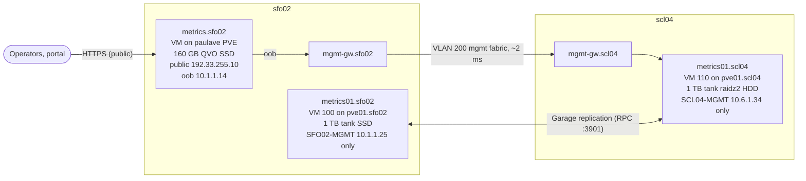
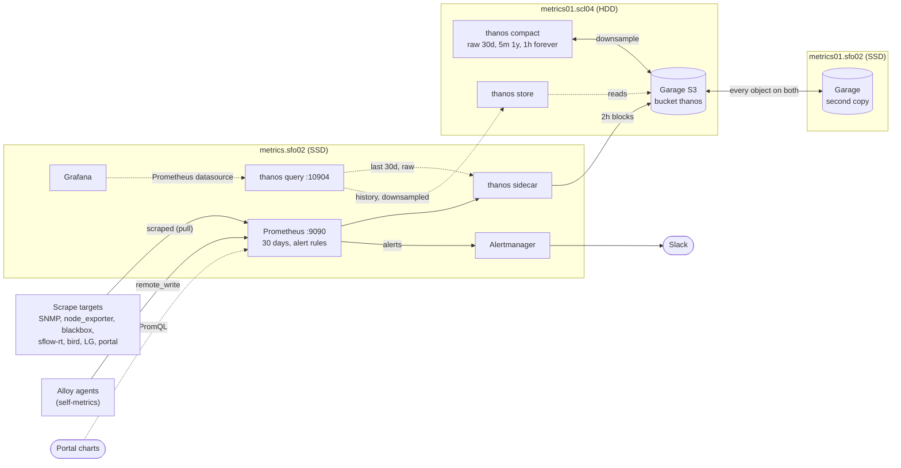
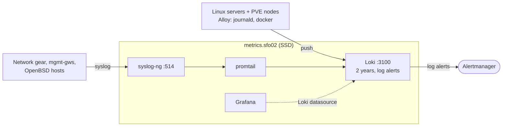

# 012 — Long-term metrics: Thanos with a downsampled bucket on spinning disk

Status: deployed 2026-11-10 (see Rollout for the two deferred retention flips).

## Why

Everything lives on metrics.sfo02: one 160 GB VM disk on the paulave nodes'
Samsung 870 QVO (QLC SSD) ZFS mirror. Measured 2026-11-09:

| | On disk | Growth | Retention |
|---|---|---|---|
| Prometheus | 78 GB, 20 blocks back to 2026-03-01 | ~0.5 GB/day at 133k head series (was ~15-20k in March) | `retention.size=80GB` — **full**; already deleting March |
| Loki | 2.7 GB chunks | ~8 MB/day stored (~270 MB/day ingested) | 90d (`job="docker"` 30d) |

Prometheus history is shrinking as series grow (~5 months at today's rate),
and there is no long-term metrics story at all.

pve01.scl04 has a 29 TB raidz2 of spinning disk (`tank`, ~20 TB free), and
on these hosts the HDD pool actually beats the QVO SSDs on fsync latency
(p50 ~10 ms vs 90-150 ms, see the PVE QVO notes).

Logs don't need a tier: at ~3 GB/year, Loki keeps **2 years** on
metrics.sfo02's SSD as a single instance with one Grafana datasource. (An
archive Loki on scl04 fed by an ingest tee was considered and dropped: two
Lokis and two log datasources for data this small isn't worth it.)

## Shape

Solid arrows carry data in (writes); dotted arrows are queries.

**Hosts and network path.** Only metrics.sfo02 talks to the cold tier, over
the management network. The bucket lives on two Garage nodes in two sites;
every object is on both.

**Metrics.** Prometheus keeps 30 days on SSD; the sidecar ships every 2h
block to the bucket; the compactor downsamples; Grafana reads both tiers
through Thanos Query.

**Logs.** Unchanged path, single Loki, retention raised to 2 years.

| Host | Where | Network | Storage | Runs |
|---|---|---|---|---|
| metrics.sfo02 | VM on paulave PVE (sfo02) | public 192.33.255.10 + oob 10.1.1.14 | 160 GB, QVO SSD mirror | Prometheus, thanos sidecar + query, Loki, syslog-ng, promtail, Alertmanager, Grafana, exporters, sflow-rt |
| metrics01.scl04 | VM 110 on pve01.scl04 | SCL04-MGMT 10.6.1.34 only | 32 GB OS + 1 TB data, tank raidz2 HDD | Garage, thanos store + compact |
| metrics01.sfo02 | VM 100 on pve01.sfo02 (DL360) | SFO02-MGMT 10.1.1.25 only | 32 GB OS + 1 TB data, tank SSD | Garage (second copy) |

## Prometheus → Thanos

- **Prometheus** keeps scraping and evaluating every alert, with local
  retention cut to 30 days (60 GB ceiling). Local compaction is turned off
  (`min/max-block-duration=2h`) so the sidecar can ship each 2h block, and
  `external_labels: {prometheus: metrics.sfo02.sfmix.org}` labels the blocks.
- **thanos sidecar** (metrics.sfo02) uploads blocks to the bucket. Uploads
  retry, so a WAN or scl04 outage only delays shipping (blocks stay local for
  30 days).
- **Garage** (metrics01.scl04) is the S3 store: single node,
  `replication_factor = 1`, data on raidz2 (the redundancy is ZFS's). Chosen
  over MinIO because MinIO's community edition stopped shipping binaries and
  images and went into maintenance mode in 2025.
- **thanos compact** (metrics01.scl04) compacts and **downsamples**: 5-minute
  aggregates for blocks older than 40 hours, 1-hour aggregates for blocks
  older than 10 days. Retention per resolution: **raw 30d, 5m 1y, 1h
  forever**. Long-term data is low-resolution by design; raw is only kept as
  long as Prometheus keeps it locally.
- **thanos store** (metrics01.scl04) serves the bucket over gRPC.
- **thanos query** (metrics.sfo02) fans out to the sidecar (recent) and the
  store gateway (history) with `--query.auto-downsampling`, so a 2-year graph
  reads 1h data rather than raw. The existing Grafana "Prometheus"
  datasource (same uid) now points at it, so every dashboard spans both tiers
  without edits. If scl04 is unreachable, queries return partial results
  from the sidecar with a warning instead of failing. The portal still
  queries Prometheus :9090 directly (its charts are short-range).

The compactor and store gateway sit next to the bucket because they move the
most data; the querier sits next to Grafana. metrics.sfo02 has 2 vCPU / 7 GB
and only gains the two light components.

Rejected: VictoriaMetrics (OSS has no downsampling — needed: long-term data
is low-resolution by design); Mimir (far too big for one Prometheus).

## Two copies: second Garage node at sfo02

pve01.scl04's `tank` is eight 8.5-year-old ST4000DM000s, one with a latched
SMART error, and the host has no backup job. raidz2 is not enough on its own
for the only copy of the long-term history, so the bucket is a two-node
Garage cluster, **replication_factor 2**, one node per site (zone = site):
metrics01.scl04 and metrics01.sfo02 (VM 100 on the DL360 pve01.sfo02, its
1.8 TB SSD `tank`). Every object, raw and downsampled, is on both.

- Thanos store + compact stay on scl04 only (one compactor per bucket); the
  sfo02 node is Garage-only. Thanos talks to scl04's S3 endpoint.
- With two nodes and the default `consistent` mode, either node down makes
  the bucket read-only: sidecar uploads and compaction retry and catch up
  (blocks wait on metrics.sfo02 for 30 days); reads keep working.
- Changing the replication factor of a cluster that holds data is officially
  unsupported. Done once, 2026-11-10, with every raw block still on
  metrics.sfo02 as the fallback: stop thanos-compact/store and garage on
  scl04, back up `meta/` (kept as `/srv/telemetry/garage-meta-backup-rf1-*`),
  move `meta/cluster_layout` aside, deploy RF 2 to both nodes, assign both,
  apply layout v1. Keys, bucket and all 296 objects (102.2 GB) came through;
  sfo02 pulled every block in the background. A node learns of blocks via
  metadata sync and schedules each fetch 2x rpc_timeout later (restarting
  Garage pushes that out again); `garage repair blocks` cannot pull queued
  entries earlier. Speed it with `garage worker set -a resync-worker-count 4`
  and `resync-tranquility 0`.
- Garage's API logger is at warn: Thanos probes every block for optional
  marker files (`deletion-mark.json`, `no-compact-mark.json`,
  `no-downsample-mark.json`) on every sync, and each absent one is a 404 that
  Garage logs at info (~2k lines/h, all benign).

## metrics01.scl04

- PVE VM 110 on pve01.scl04 (NetBox VM 21), Debian 13 cloud image,
  4 vCPU / 8 GB.
- **Management network only**: SCL04-MGMT (`vmbr0`, VLAN 701)
  10.6.1.34/24, gw 10.6.1.1, IPv4 only (scl04's OOB has no working IPv6).
  It hosts no public frontend and no ingestion endpoint that public hosts
  need — only metrics.sfo02 talks to it, over oob (10.1.1.14 → 10.6.1.0/24
  via mgmt-gw.sfo02, ~2 ms). S3 and Thanos gRPC are unauthenticated, so they
  belong off public addresses anyway. UFW's admin allow (10/8) covers
  metrics.sfo02.
- Ansible reaches it via `ProxyJump shell.sfmix.org`; role `metrics_archive`
  (`push_servers -t metrics_archive`).
- Disks: 32G OS + **1T thin data disk** (scsi1, ext4 `LABEL=telemetry` on
  `/srv/telemetry`), both on `tank-vms`. Grow with `qm resize 110 scsi1 +NG`
  then `resize2fs`.
- Not backup01.scl04: that VM keeps a public IP to receive backups from
  public-only hosts, and is a backup target, not a query service.

Expected steady state: raw 30d ~15 GB, 5m for a year ~50-100 GB, 1h ~10
GB/yr. The 1T disk is years of headroom.

### Retention runway (how long "forever" lasts)

The Garage volumes are fixed 1 TiB disks, so "1h forever" really means "until
the disk is full". The Long-term Metrics dashboard projects that per copy
(RF 2 on 2 nodes = each node holds everything, so the smaller one limits):

- ceiling = (size − ext4 root reserve) × 90%, from node_exporter on
  `/srv/telemetry`;
- compression = disk used ÷ block bytes (live + pending delete), ~0.70;
- growth per resolution = block bytes per day of data in the newest 30 days
  (thanos-bucket-coverage), not the lifetime average: series grew from ~15k
  to ~145k during 2026, and 1h blocks went from ~3 to ~22 MB/day;
- raw and 5m settle at growth × retention; 1h gets the rest:
  runway = (ceiling ÷ compression − raw − 5m − 1h so far) ÷ 1h growth/yr.

2026-11-10: ceiling 924 GB, raw+5m settle at ~61 GB on disk, 1h adds
~5.5 GB/yr on disk → ~155 years; 72 at 2× ingestion, 22 at 5×, 6 at 10×.
Ingestion growth, not disk, is what to watch.

## Rollout (no data loss)

The existing 78 GB of history is uploaded once, and nothing is allowed to age
out anywhere until it is verified in the bucket:

1. Compactor runs with `-e metrics_archive_thanos_retention_raw=0d` (keep all
   raw) during the backfill.
2. Prometheus deploy with `-e prometheus_retention_time=
   -e prometheus_retention_size=95GB -e thanos_sidecar_upload_compacted=true`:
   no time retention, a size ceiling above today's 80 GB so the oldest blocks
   stop being deleted, and the sidecar uploads the already-compacted history.
   This is the one container restart (TSDB/WAL replay, a short scrape gap).
3. Verify: every local block ULID is in the bucket (`thanos.shipper.json` vs
   `thanos tools bucket ls`), then redeploy Prometheus with the defaults
   (30d / 60GB, no upload-compacted).
4. Verify 5m and 1h blocks cover the whole history, then redeploy the
   compactor with the default raw retention (30d).
5. Grafana "Prometheus" datasource → Thanos Query; Loki retention → 2y
   (`-t datasources,loki`).

Done 2026-11-10: the Prometheus restart cost one 94 s scrape gap (06:07:03 →
06:08:37 UTC, WAL replay 21 s). Backfill 06:08 → 07:22 UTC (~15 MB/s over
the mgmt path); all 20 local blocks verified in the bucket with identical
time ranges, sample and series counts (39.4 B samples, 2026-03-01 →
2026-11-10). Thanos Query returns identical results to Prometheus over the
overlapping range. The sidecar's upload-compacted flag is off again.

Deferred, deliberately:
- ~~Local 30d / 60GB~~ done 2026-11-10 17:07Z together with the Prometheus
  2.43 → **3.13.5** upgrade (pinned; 3.13 is the LTS line). One restart,
  timed 4 min after the odd-hour head compaction so the WAL replay was 15 s;
  measured gap ~70 s on 30 s jobs, one or two missed scrapes on 60 s jobs.
  Retention deleted ~60 GB of local blocks (all verified in the bucket); disk
  free on metrics.sfo02 went 48 → 106 GB, Prometheus RSS 1.2 → 0.4 GB.
  Pre-checks: promtool (config + 9 rule files), every non-Go target's
  Content-Type scraped by a throwaway v3.13.5 (all up), no `le=`/`holt_winters`
  usage. `memory-snapshot-on-shutdown` + `stop_timeout: 120` make later
  restarts load a head snapshot instead of replaying the WAL.
  **Rollback:** `prometheus_image: prom/prometheus:v2.55.1` (the only 2.x that
  reads 3.x TSDB; pre-pulled on metrics.sfo02).
- ~~Bucket raw 30d~~ done 2026-11-10: 5m coverage passed the 30-day line
  (08:22Z) and the second copy was verified, then raw retention went to 30d.

Second copy, 2026-11-10: sfo02 pulled every block 08:48 → 10:35Z (~66 GB on
disk after Garage compression, 0 errored blocks). Verified: both nodes hold
98,436 block files totalling 70,175,989,361 bytes against 98,435 block
references, and a full `garage repair --all-nodes blocks` afterwards found
nothing missing on either node.

## Alerts

`thanos.rules.yml`: any Thanos component or Garage down, sidecar upload
failures, no block shipped in 6h, compactor halted, compactor not completing
runs, and bucket capacity (below).

## Bucket capacity

Measured 2026-11-10: 1h 2.35 GB for Mar → Nov, 5m 22.7 GB, raw 78.9 GB
(backfill, trimming to ~15 GB); ~954 GB free per node. Only the 1h tier grows
without bound (~5-15 GB/yr at ~133k series), so 1 TB lasts decades unless
cardinality explodes. A full node is not self-healing, though: with
replication 2 writes stall, the sidecar stops shipping (and Prometheus's 30d
local retention eventually drops unshipped blocks), and the compactor (scratch
on the same `/srv/telemetry` on scl04) can't compact, so retention stops too.

Alerts (`component: telemetry`): `GarageDiskLow` (<25% free),
`GarageDiskCritical` (<10%), `GarageDiskFillingUp` (30d trend → full within
90d, only once >50% used so a backfill or resync doesn't trip it),
`ThanosForeverTierGrowingFast` (1h tier +5 GB in 30d: a cardinality blow-up
being written in permanently).

Making room, in order:
1. Grow the disk: thin zvols, `qm resize <vmid> scsi1 +NG`, `resize2fs`, raise
   `metrics_archive_garage_capacity`. sfo02's 1.8 TB SSD pool is shared and
   is the tighter of the two.
2. Shorten `metrics_archive_thanos_retention_5m`: per day it costs ~10× the 1h
   tier, which already covers the same span.
3. Drop the oldest 1h blocks (~2-week blocks):
   `thanos tools bucket mark --marker=deletion-mark.json --id=<ULID>
   --details=capacity`; the compactor deletes after `--delete-delay=48h`.

Never delete objects in Garage directly or with S3 lifecycle rules: they act
on upload time (compaction re-uploads old data) and remove a block's files
piecemeal, which halts the compactor.

## Query guard rails

Prometheus caps a query at 50M loaded samples by default; Thanos Query has no
cap at all. 2026-11-11 a 30d "Overall Traffic Breakdown" panel over the 5s
`sflow_ixp_peering_bps` series (~1000 live series, ~500M raw samples per 30d)
grew the sidecar to 3.2 GB and query to 2 GB on the then-8 GB metrics.sfo02.
The VM swap-thrashed for 25 min (load ~150, sshd unresponsive, looked like a
reboot) until the kernel OOM-killed the sidecar.

Now (`roles/prometheus/defaults`): sidecar and query run with docker memory caps
and swap disabled plus `GOMEMLIMIT`, so a runaway query kills one container
rather than freezing the VM; `--query.timeout=30s` (Grafana's datasource
timeout) cancels work nobody is waiting for; per-selector
`--store.limits.request-{samples,series}` fail oversized selects. The VM went
8 → 12 GiB (pve02-paulave200-sfo had ~11 GB free).

High-churn 5s sflow-rt series still can't be graphed raw past ~2 days within
30s; long ranges over them need recording rules at a coarser interval.
