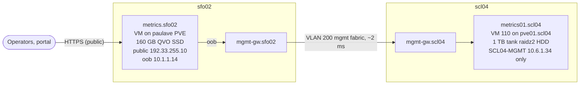
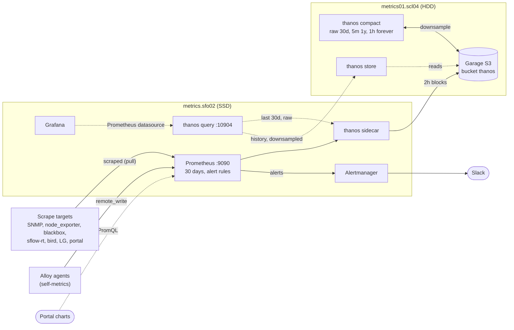
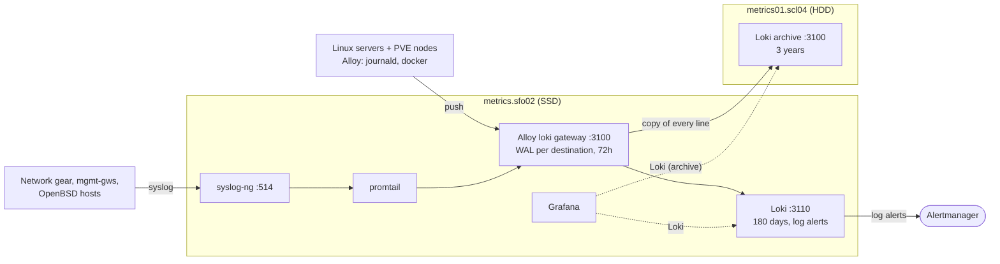

# 012 — Long-term telemetry storage: Thanos + a Loki archive on spinning disk

Status: proposed (2026-11-09).

## Why

Everything lives on metrics.sfo02: one 160 GB VM disk on the paulave nodes'
Samsung 870 QVO (QLC SSD) ZFS mirror. Measured 2026-11-09:

| | On disk | Growth | Retention |
|---|---|---|---|
| Prometheus | 78 GB, 20 blocks back to 2026-03-01 | ~0.5 GB/day at 133k head series (was ~15-20k in March) | `retention.size=80GB` — **full**; already deleting March |
| Loki | 2.7 GB chunks | ~8 MB/day stored (~270 MB/day ingested) | 90d (`job="docker"` 30d) |

Prometheus history is shrinking as series grow (~5 months at today's rate),
and there is no long-term metrics story at all. Loki is tiny but has no copy
anywhere else.

pve01.scl04 has a 29 TB raidz2 of spinning disk (`tank`, ~20 TB free), and
on these hosts the HDD pool actually beats the QVO SSDs on fsync latency
(p50 ~10 ms vs 90-150 ms, see the PVE QVO notes).

## Shape

Three views of the same system. Solid arrows carry data in (writes);
dotted arrows are queries.

**Hosts and network path.** Only metrics.sfo02 talks to the cold tier, over
the management network.

**Metrics.** Prometheus keeps 30 days on SSD; the sidecar ships every 2h
block to the bucket; the compactor downsamples; Grafana reads both tiers
through Thanos Query.

**Logs.** Senders are unchanged; the Alloy gateway that now owns :3100 writes
every line to both Lokis, each through its own disk buffer.

| Host | Where | Network | Storage | Runs |
|---|---|---|---|---|
| metrics.sfo02 | VM on paulave PVE (sfo02) | public 192.33.255.10 + oob 10.1.1.14 | 160 GB, QVO SSD mirror | syslog-ng, promtail, Alloy gateway, Loki, Prometheus, thanos sidecar + query, Alertmanager, Grafana, exporters, sflow-rt |
| metrics01.scl04 | VM 110 on pve01.scl04 | SCL04-MGMT 10.6.1.34 only | 32 GB OS + 1 TB data, tank raidz2 HDD | Garage, thanos store + compact, Loki archive |

### Prometheus → Thanos

- **Prometheus** keeps scraping and evaluating every alert, with local
  retention cut to 30 days. Local compaction is turned off
  (`min/max-block-duration=2h`) so the sidecar can ship each 2h block, and
  `external_labels: {prometheus: metrics.sfo02}` labels the blocks.
- **thanos sidecar** (metrics.sfo02) uploads blocks to the bucket. Uploads
  are pull-free and retried, so a WAN or scl04 outage only delays shipping
  (blocks stay local for 30 days). The one-time backfill of the existing
  compacted history runs with `--shipper.upload-compacted`
  (`thanos_sidecar_upload_compacted: true` for one deploy).
- **Garage** (metrics01.scl04) is the S3 store: single node,
  `replication_factor = 1`, data on raidz2 (the redundancy is ZFS's). Chosen
  over MinIO because MinIO's community edition stopped shipping binaries and
  images and went into maintenance mode in 2025.
- **thanos compact** (metrics01.scl04) compacts and **downsamples**: 5-minute
  aggregates for blocks older than 40 hours, 1-hour aggregates for blocks
  older than 10 days. Retention per resolution: **raw 30d, 5m 1y, 1h
  forever**. Long-term data is low-resolution by design; raw is only kept as
  long as Prometheus keeps it locally.
- **thanos store** (metrics01.scl04) serves the bucket over gRPC.
- **thanos query** (metrics.sfo02) fans out to the sidecar (recent) and the
  store gateway (history) with `--query.auto-downsampling`, so a 2-year graph
  reads 1h data rather than raw. The existing Grafana "Prometheus"
  datasource (same uid) now points at it, so every dashboard spans both tiers
  without edits. If scl04 is unreachable, queries return partial results
  from the sidecar with a warning instead of failing.

The compactor and store gateway sit next to the bucket because they move the
most data; the querier sits next to Grafana. metrics.sfo02 has 2 vCPU / 7 GB
and only gains the two light components.

Rejected: VictoriaMetrics (OSS has no downsampling — needed: long-term data
is low-resolution by design); Mimir (far too big for one Prometheus).

### Loki → archive copy

Loki can't replicate to a second store, so the copy is made at ingest:

- Loki's own HTTP API moves from :3100 to **:3110**.
- The Alloy agent already on metrics.sfo02 takes over **:3100** with a
  `loki.source.api` receiver (`use_incoming_timestamp = true`) feeding two
  `loki.write` components: the local Loki and the archive Loki on
  metrics01.scl04. Each has its own disk WAL, so an archive outage never
  stalls the primary and replays when scl04 comes back.
- Senders (every Alloy agent, promtail's syslog path) are unchanged: they
  still push to metrics:3100.
- **Retention:** primary raised 90d → **180d** (~1.5 GB); archive **3 years**
  (~10 GB at today's rate). Logs aren't downsampled; the archive is a
  full-fidelity copy.
- Grafana gets a second datasource, "Loki (archive)", for anything older
  than 180 days. Log alerts (the ruler) stay on the primary only.

Rejected: rsyncing the primary's chunk directory (the compactor rewrites
index files; a copy that skips deletions keeps both versions); dual-writing
from every sender (20+ hosts each needing a path and firewall to scl04, vs
one hop from metrics).

## metrics01.scl04

- PVE VM 110 on pve01.scl04, Debian 13 cloud image, 4 vCPU / 8 GB.
- **Management network only**: SCL04-MGMT (`vmbr0`, VLAN 701)
  10.6.1.34/24, gw 10.6.1.1, IPv4 only (scl04's OOB has no working IPv6).
  It hosts no public frontend and no ingestion endpoint that public hosts
  need — only metrics.sfo02 talks to it, over oob (10.1.1.14 → 10.6.1.0/24
  via mgmt-gw.sfo02, ~2 ms). Loki, S3 and Thanos gRPC are unauthenticated,
  so they belong off public addresses anyway. UFW's admin allow (10/8)
  covers metrics.sfo02.
- Ansible reaches it via `ProxyJump shell.sfmix.org`.
- Disks: 32G OS + **1T thin data disk** (scsi1, ext4 `LABEL=telemetry` on
  `/srv/telemetry`), both on `tank-vms`. Grow with `qm resize 110 scsi1 +NG`
  then `resize2fs`.
- Not backup01.scl04: that VM keeps a public IP to receive backups from
  public-only hosts, and is a backup target, not a query service.

Expected steady state: raw 30d ~15 GB, 5m for a year ~50-100 GB, 1h ~10
GB/yr, Loki ~3-4 GB/yr. The 1T disk is years of headroom.

## Rollout

1. Create VM 110, DNS, `push_servers --limit metrics01.scl04 -t sfmix_server`,
   `deploy_log_agent --limit metrics01.scl04`,
   `push_servers --limit metrics01.scl04 -t metrics_archive`.
2. metrics.sfo02 Prometheus: external labels, 2h blocks, 30d, sidecar with
   `-e thanos_sidecar_upload_compacted=true` (container restart → one TSDB
   replay). Watch the backfill (~78 GB over the mgmt path), then redeploy
   without the flag.
3. thanos query + Grafana datasource switch.
4. Loki :3110 + Alloy gateway on :3100, in that order (`-t loki`, then
   `deploy_log_agent --limit metrics.sfo02`). Senders buffer in their WALs
   for the seconds in between.

## Alerts

`thanos.rules.yml`: sidecar upload failures, compactor halted or not
running, bucket not updated in 6h, store gateway down, and Garage down.
The archive copy failing shows up in the existing `AlloyWriteFailing`
(metrics.sfo02 drops) and the new `LokiArchiveDown`.
